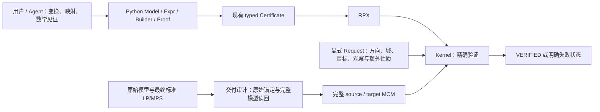

# Kernel 与 Compiler 项目成果：论文准备报告

本文整理整个项目截至 2026-10-15 的正面成果及其可引用证据，覆盖早期 Kernel 工作、历史完整验收、性能优化、Python Compiler 和真实 Agent 实验。最后一轮 C10 的十个 Agent 已全部结束，五个 Compiler 交付均通过独立正式验证；提交后质量测量进行中。历史资料保持各自截止版本。

最扎实的结果包括：完整原始合同下的 81 个真实算例和 83 次验证；带精确有理数、完整模型义务和联合构造见证的 Kernel；不经过 RPA 的 Python 证明 API；跨全部冻结版本的 83 份证书兼容性回放；以及连续成熟阶段 C5–C9 的 32 次自主正式交付。这些是不同实验单位，不能相加为独立算例数。

同一任务上的工程结果也有独立证据：共享作用域、有理数快捷路径，以及保持完整证明字节和验证统计的 Compiler 序列化回归。各项测量以下文给出的固定版本、样本和条件为准。

## 系统与贡献边界



Python Compiler 与作者脚本提供证明，不是数学接受权威。Kernel 的 TCB 包含可信格式入口、精确算术、推导执行和 native 联合存在引理的实例化器。交付审计另外检查原始输入、完整标准模型和多段交付的连接。每项 VERIFIED 只确立实际 Request 中的性质，不能升级为未声明的完整逆、LP 等价或自然语言报告。

Python 主路径为 **Python 对象 → existing Certificate → RPX → Kernel**，没有 RPA 中间步骤，也不寻找变换或非平凡证明。项目另有独立的 RPA / 可读 RPA-S 显式作者工具，它们不参与此 Python 编译路径。MCM v1 和 RPX v1–v10 已冻结。

## Kernel 的项目级正面结果

可以支撑论文主线的结果是：**项目实现了一个面向 MILP reformulation 的精确证明检查核心，将作者给定的完整模型关系与具体推导分离；除了仿射映射，还支持带联合存在条件的构造式恢复，并以原始合同审查、实际模型验收、独立精确算术与字节测试，以及限定条件下的性能实验提供证据。** 这里的贡献表述不包含文献中的优先权或首创性比较。

### 可直接使用的 12 项主张

**K01：统一的精确 MILP 语义与实际格式入口。** 模型坐标取实数，整数性由声明限定；行、边界、目标系数及常数用精确有理数计算。可信 MPS/LP 入口将支持的格式子集规范到同一 MCM 模型，包括完整 MAX 目标的符号转换，不依赖浮点容差接受证明。历史 MPS 扫描完成 **159/159 文件**的规范化；三个实际 LP 模型由独立的 stdlib Fraction 解析器与独立 MCM 解码器交叉核对，另有 **160 个生成 LP 模型**。这说明实际格式可进入同一精确检查流程；它没有覆盖所有厂商扩展，合法数学输入也可能因资源政策被拒绝。[MPS 规范](MPS_V1.md)、[LP 规范](LP_V1.md)、[语义](SEMANTICS.md)

**K02：证明对象绑定完整、可区分的关系合同。** 调用者单独提供有序 Request，证书必须逐字段匹配。Kernel 从实际完整输出模型产生每个 Return 的所有边界、整数性、行、目标关系及观测义务；作者不能通过省略难证明的输出坐标或行来缩小合同。每个终端是一组同时成立的完整输出坐标，穷尽分支可以给出不同坐标组。MI/LP 输入输出域、Equal/NonIncreasing/None 目标、投影、逆映射、条件域和更强的双射是独立合同，不能由较弱合同自动升级。这是论文中比单纯“验证成功”更重要的接受条件。[语义](SEMANTICS.md)、[原始合同审查](../audit/DELIVERY_LEDGER_REVIEW.md)

**K03：五类具有联合存在论证的构造式恢复。** Flow、Interval、Menu、Signed、Subflow 五类规则使证明不局限于一条原坐标上的仿射逆映射。规则先在父作用域验证作者给定的全部前提，再扩展一组联合可行的新坐标，保留原模型前缀与目标。已有独立精确有限检查包括 Flow 的 **97 fixtures / 186 groups**、Interval 的 **241 fixtures**、Menu 的 **241 fixtures 与 16,382 个二进制向量**、Subflow 的 **983 Fraction fixtures**；这些是不同用途的有效与无效控制，不能相加作为统一覆盖率。联合存在引理及其 native 实例化器属于 TCB，后续检查 Return 并不会让它们变成不可信代码。[信任边界审查](../audit/LIFT_TRUST_REVIEW.md)、[Subflow 引理](SUBFLOW_V10.md)、[生产审查](../audit/SUBFLOW_PRODUCTION_REVIEW.md)

**K04：完整双射，以及互不混淆的 LP 严格性见证。** 完整单射性通过两个新鲜的实际输入域副本检查：完整前向像相等时，必须推出每个原始输入坐标相等，包括未观测的连续坐标；构造式逆向恢复可以分支或扩展。另有不同合同分别表达 LP 严格包含、固定观测后不存在任何输入补全，以及一个完整仿射像落在实际对侧 LP 域外。独立检查覆盖 **80 个单射模型 / 640 点对**、**120 个 fiber box cases**、**1,875 个 image oracle 点**。实际 test62 保留原 MI/双射合同，同时加入 **4,500 坐标完整 LP 点与 500 坐标实际像**的排除见证。像排除不等于 LP 包含，也不等于部分观测无补全。[完整双射](MENU_V7.md)、[Fiber 合同](FIBER_POINT_V6.md)、[像排除审查](../audit/IMAGE_EXCLUSION_REVIEW.md)

**K05：可处理任意小连续改进的严格优化合同。** 对显式仿射谓词 `p>0`，证书构造同一完整实际域内严格更优的点。正有理数比例余量 `epsilon*p` 允许连续变量产生任意小的正改进，不强加不存在的统一最小间隔。结合 `p<=0` 上的完整条件对应，可以保留每个已达到最优点的指定坐标，而不假设最优值一定达到。独立检查有 **1,000 次完整 verifier 调用**；实际 test36 覆盖 **200 个连续 terminal、37,616 个保留观测与 529,636 个义务**。实际 test83 给出 **65,832 坐标**的改进组，同时处理 **61 个**被支配非负坐标，独立稀疏代换确认 **100 条原等式**保持不变，最小正节省为精确的 `161497/1000000`。连续网格检查不是对实数域的穷尽证明；一般正确性来自已陈述的规则论证与其可信实现。[严格改进审查](../audit/STRICT_IMPROVEMENT_REVIEW.md)、[test36 完整审查](../audit/TEST36_COMPLETE_REVIEW.md)

**K06：完整原始合同的 81 例交付，包含五项实质 scope 修复。** 历史交付最终完成 **81 个实际案例、83 次完整验证调用、11 类相互重叠的结构族**。test46 的三段是同一实际模型对上的三个独立完整 Request，不能靠跨文件状态凑出方向。更有价值的是验收没有停在“当前 Request 被接受”：独立审查发现并关闭了以下原始合同缺口。

| 案例 | 完成的原始性质 |
| --- | --- |
| test36 | 对全部连续 terminals 的严格排除，并给出零面上完整保留投影及逆向合同 |
| test46 | 两个 MI 目标/投影方向，以及 target→source 的 LP 方向 |
| test58 | MI 前向不增、逆向相等，使用一组联合需求受限子流见证 |
| test62 | 保留 MI/双射，并对实际完整 LP 点及其完整像检查实际对侧约束违反 |
| test83 | 任一被支配非负坐标为正时严格改进，同时保留先前方向合同 |

冷构建时的 **262 tests**、2026-10-14 freeze 的 **280 tests**、2026-10-15 当前集成套件的 **344 tests / 41 result groups / 0 failures** 是三个不同截止；344 包含后续 Compiler、authoring 和 CLI 测试。这些数字是回归覆盖，不是 344 个独立 soundness 定理。历史 81 例由已准备证明验收，不能称为 81 次 fresh Agent 自主发现。[最终交付](../audit/FINAL_DELIVERY_REPORT.md)、[scope 审查](../audit/DELIVERY_LEDGER_REVIEW.md)、[当前测试收据](../audit/compiler-performance/C10-preflight-20261015/validation.json)

**K07：冻结的规范格式与独立字节实现。** **MCM v1、RPX v1–v10 已于 2026-10-14 冻结**，包含显式版本门限、规范有理数、排序稀疏表达式、非法标志/保留位及尾部字节拒绝。独立 Python struct/Fraction 实现直接写出 bytes，Rust 解码后精确验证并逐字节重编码；它不调用 Rust 编码器制造自洽 oracle。条件域 fixture 检查 **354 个截断、2,520 个非法 flag/reserved 变体**；组合 V10 fixture 另有 **386 个截断、5,601 个非法 flag/reserved 变体**。冻结的 **65 页手册**有 **39 项 CLI 检查**，包括 9 项 INVALID、3 项 RESOURCE_LIMIT 和规范字节回环。FINAL_DELIVERY_REPORT 的旧 draft/unfrozen 叙述早于 freeze，当前状态以较新 freeze 文档为准；freeze 是兼容性决定，不是实现机械化证明。[冻结决定与收据](../audit/PROTOCOL_V9_V10_FREEZE.md)、[统一格式](FORMAT.md)

**K08：保持相同证书任务的内存表示改进。** 历史 frozen-v3 的单项 A/B 将 Step 槽从 **208 B 降到 96 B**，23 个固定 workload 的模型、RPA、RPX、Request 和数学计数均相同，**207 timing + 69 独立 RSS 进程全部 VERIFIED**。history65536 的 peak RSS 中位数从 **53.25 降到 39.25 MiB（26.3%）**；实际 test88 从 **51.125 降到 43.219 MiB（15.5%）**。该结果只改变内存布局；它不意味着 RPX 变小、证明流式解码或普遍降低延迟，报告保留了小任务回退。[同字节表示实验](../bench/BOXED_CASES_REPORT.md)

**K09：共享作用域消除已观测到的平方级事实复制。** 历史 frozen-v5 A/B 将父事实复制改为不可变祖先借用、局部定义及删除掩码，并继续计费实际查找 probes。在预先固定的 n=4096 copying-heavy 任务中，执行中位数从 **827.142 降到 6.517 ms，约 127×**；较广的 23-workload A/B **552 进程全部 VERIFIED**，实际 test88 为 **182.553→120.189 ms**。独立参考状态机核对 **127,072 次操作**。实际 test18 的原 RPX/MCM/Request 一字不变，在相同 work ceiling 下由 RESOURCE_LIMIT 变为 VERIFIED。旧失败不能作为成功运行时间的分母；127× 只归属于指定任务族，非分支任务存在约 3% 的回退。去掉复制后 work 数改变是实际计费对象改变，其他数学计数与字节保持一致。[共享作用域实验](../bench/SHARED_SCOPE_REPORT.md)、[独立状态审查](../audit/SHARED_SCOPE_REVIEW.md)

**K10：保持精确性及相同 work 的有理数优化。** 历史 frozen-v7 与仅含 denominator-one、±1、零项快捷路径的 prototype，在 **49 个固定 paired workload**上保持全部 artifact hashes 和完整数学统计相同；**882 timing + 294 RSS = 1,176 进程全部 VERIFIED**，49 个执行中位数均降低。实际 test57 为 **4,932.676→2,219.925 ms（55.0%）**，test65 为 **3,776.316→1,795.367 ms（52.5%）**。条件是 Apple M5、10 cores、16 GiB、macOS 26.6.2、rustc 1.96.0 locked release、warm files、fresh processes，重负载 worker 暂停，顺序窗口而非随机交错；报告保留全部样本和异常值。四个启动主导任务的 process 中位数回退，RSS 变化在 3% 内。测得的 prototype 与后来的生产 binary 不能混用；后续 V10 回归报告也保留了真实变慢，不能把本项概括成所有版本全面加速。[有理数 A/B](../bench/RATIONAL_SHORTCUTS_REPORT.md)、[独立复核](../audit/rational_benchmark_review.md)、[后续回归](../bench/V10_REGRESSION_REPORT.md)

**K11：高级完整合同已有分阶段绝对性能基线。** 历史 complete-v10 冷 binary `96a6d304…b9c8f8` 的独立窗口覆盖 **22 workloads、264 次验证/RSS 进程、63 次 synthetic preparation**。实际 test58 的完整合同检查执行中位数 **18.369 ms**、完整进程 **28.749 ms**、peak RSS **31.891 MiB**。n1024/g4 子流任务生成 **12,280 变量、16,376 行**，执行中位数 **56.732 ms**；完整作者准备为 **9,153.946 ms**，包含作者端简单的 O(nm) 构造，不能隐去。4096 坐标 strict-improvement、image-exclusion、halfspace 任务分别为 **2.046、2.294、4.646 ms** 执行中位数。它们是同一 host 上新能力的绝对基线，不是对不支持该能力的旧版本的 speedup ratio。[完整分阶段表与原始数据哈希](../bench/NEXT_CAPABILITY_DRAFT_BASELINE.md)

**K12：Compiler 接入保留历史核心行为，并已有 fresh 实际使用。** Direct Certificate JSON→RPX 对全部 **81 例 / 83 pieces / RPX v1–v10**重现 byte-identical RPX；与独立构建的 pre-compiler `c16fdaf` 比较，**83/83 完整 Request 的全部 Statistics 一致**。累计处理 **4,090,495,643 B JSON 与 2,906,200,909 B RPX**。这是已作者给定证明的兼容性回放，不是自主证明发现；旧 RPA fixture 去掉 header 仅用于取测试数据，compiler 本身不经过 RPA parser/assembler。另有独立证据：C9 的八个不同已测输入（28、38、60、62、70、80、65、85）上，**8/8 fresh Compiler Agent 完成正式 Kernel 验证**，全部 16 个配对 arms 正常结束，保留完整源锚定与提交目标模型 readback；该轮使用 frozen539 包与旧 native5775，不能视作当前 API 的全量 fresh 验收。它证明实际可用的端到端完整合同，不证明任意改写都同样自然、无意愿偏差或与 Nomf 近似时间/质量。最终 C10 在本稿准备时仍在运行，结果未纳入。[pre-compiler 对照](../audit/compiler-replay/README.md)、[机器汇总](../audit/compiler-replay/summary.json)、[C9 正式验收记录](../audit/compiler-agent/C9-summary.json)

### 论文叙述与复现边界

适合使用“精确检查”“caller-bound complete contracts”“经独立有限 oracle 与实际案例验收”“冻结的可互操作格式”等表述。证明层次应分别写清：文档中的数学 soundness/联合存在论证、这些规则的可信 Rust 实现、独立有限检查、完整实际模型执行、fresh Agent 的自主使用。当前没有 Lean 或其他形式化系统对整个 Rust 实现的机械化正确性证明；也没有据此宣称普适无错或对所有 MILP reformulation 的完备性。

核心 TCB 包含格式解析、精确算术、推导执行及 native 构造引理实例化。Python Compiler、作者脚本和 metadata 不构成证明权威。文件 SHA/manifest 负责定位实际输入与交付物；SHA 匹配本身不是数学证明。资源上限限制可执行范围，RESOURCE_LIMIT 不表示数学反例。

历史测量需恢复其 pinned source、Cargo.lock、binary 与本地忽略的大型模型/证明；部分历史 checkpoint/prototype 目录在交付后清理，不能假装新克隆已包含所有测量输入。JSON 每项列出后续复现入口，已有 raw receipts 保留精确命令、样本、artifact hashes 和 host。新的复现必须用新 label/output，不覆盖历史证据。本次未执行这些命令。

当前主要功能 checkpoint 是 `982235835dfe3b6c5f74188cd68ef48008747f30`，preflight native SHA-256 为 `cf9941c2daf9ab1434090069cc5040f902229e7b2d6d56003bcb0d8568e09da1`。preflight 为 **344 Rust tests、158 Python 3.9 tests、158 Python 3.14 tests**，其完整 source hashes 以既有收据为准；这些 suite 是正确性检查，耗时不当作基准。最终论文应在 C10 结束并独立审计后追加该轮结果，保持历史 corpus、兼容性 replay 与 fresh Agent 三种证据的界线。

## Compiler 的项目级正面结果

本稿汇总已有正面结果，并保留其证据边界；机器可查版本见 [compiler-positive-evidence.json](../audit/paper/compiler-positive-evidence.json)。Compiler 将作者给定的证明编译到现有 RPX，由 Kernel 决定实际 Request 是否成立。下列结果不构成“所有算例均达到 nomf 的时间与质量且探索意愿不下降”的总验收。

实验背景需要一并呈现：C1、C2 已有正式验证成功，但存在显著时间与质量差距；C3 test16 在 30 分钟内未交付证明；C4 的旧 strict harness 对链式交付真实报错，随后保留原结果并通过独立版本化 review 验证其 MI 链。后续 32/32 仅指连续成熟阶段 C5–C9，不代表全项目没有失败。

### 可用于论文的十项结论

1. **沿用现有证明对象与 wire format 的直接编译桥。** Python → Certificate JSON → RPX → Kernel，不经过 RPA，也不搜索证明。历史 81 个已验证算例的 83 个 proof piece 覆盖 RPX V1–V10：83/83 RPX 字节完全一致、完整 Request 通过、全部 Statistics 与明确的 pre-compiler `c16fdaf` 基线一致。累计处理 4.09 GB Certificate JSON 和 2.91 GB RPX；记录的编译/验证耗时分别为 36.87/128.41 s。额外 merged test46 的 432,885,906 B JSON 直接编译、完整三项契约与 1,105,551 个 obligations 通过。此项是兼容性回放，不是新 Agent 实验。 证据：[README.md](../audit/compiler-replay/README.md)、[summary.json](../audit/compiler-replay/summary.json)。

2. **可自然声明且精确回读的 Python API。** exact rational `Expr`、Model、带 scope 的 Fact、显式 obligation、deferred map、contract summary，使作者操作模型与证明对象；MCM streaming readback 保留 native 全字段。对同一 228,350 变量、126,512 行模型，old/stream 各 3 个交错 fresh process 的 load median 为 5.138/3.838 s；六次 Python MCM 重编码均等于 native oracle。该结果只衡量 load，不衡量 Agent 全流程。最新 C10 前检查为两套 Python 各 158 tests，以及包含非 Compiler 功能的整个 core 344 tests 通过。证据：[report.json](../audit/compiler-performance/model-load-stream-20261015/report.json)、[validation.json](../audit/compiler-performance/C10-preflight-20261015/validation.json)。

3. **构造性、整数和 staged 证明得到真实使用。** C6 test58 使用 SignedLift 与两个 MenuLift；C9 test60 用 1,254 个 menus 构造 13,550 个 one-hot 变量，完整 MI 双向 Equal maps 检查 51,192 个 obligations；C9 test62 用两段显式 chain、反向 IntervalLift 的 2,029 个生成变量和 30,888 branches，得到最终 460 个 observations 的 MI 双向 Equal 契约。无 LP 或全链 inverse 时明确不宣称这些性质。证据：[C6-summary.json](../audit/compiler-agent/C6-summary.json)、[C9-test60-phase.json](../audit/compiler-agent/C9-test60-phase.json)、[C9-test62-phase.json](../audit/compiler-agent/C9-test62-phase.json)。

4. **证明绑定实际输入和完整提交模型。** C9 八条 Compiler 交付均通过 trusted pristine source anchor、每段自身 canonical indices 的 native 检查，以及对最终标准模型所有变量、界、整数域、行和目标的 exact named 比较；test62 额外验证 stage join 和作者声明的 claim paths。此严格性只按版本记录适用，不倒灌为早期轮次的原始保障。证据：[C9-summary.json](../audit/compiler-agent/C9-summary.json)、[verify_staged_agent_delivery.py](../tools/verify_staged_agent_delivery.py)；早期边界见 [C1-C3-input-integrity.json](../audit/compiler-agent/C1-C3-input-integrity.json)、[C4-summary.json](../audit/compiler-agent/C4-summary.json)。

5. **连续成熟阶段的自主交付成功。** C5–C9 合计 32 次 Compiler 正式交付全部通过独立 formal 检查，并有 32 次 fresh nomf 对照。共涉及 14 个不同的既有已测算例：C5–C8 重复六题，C9 换八题。这里的 32 次不是 32 个独立算例，也不能推出未见算例族泛化。历史 83 pieces 回放、提供见证回归与 fresh Agent 的计数彼此分开。证据：[C5](../audit/compiler-agent/C5-summary.json)、[C6](../audit/compiler-agent/C6-summary.json)、[C7](../audit/compiler-agent/C7-summary.json)、[C8](../audit/compiler-agent/C8-summary.json)、[C9](../audit/compiler-agent/C9-summary.json)。

6. **完整轮次的时间观察显示工作流改善，同时保留较慢结果。** 下表使用每轮全部 Compiler/nomf Agent wall time，避免拼接各轮最快算例。C6–C8 package 固定为 `231e6f4`，但 prompt 与数学选择、最终目标及声明契约不同，不能推断独立因果或同质质量。

| 轮次 | 配对数 | Compiler 总 wall (s) | nomf 总 wall (s) | 总时间比 | 配对比中位数 | 配对比范围 |
|---|---:|---:|---:|---:|---:|---:|
| C5 | 6 | 4582.558 | 2516.589 | 1.821 | 1.641 | 0.924–3.106 |
| C6 | 6 | 3141.919 | 2427.598 | 1.294 | 1.205 | 0.838–1.888 |
| C7 | 6 | 2106.979 | 2391.847 | 0.881 | 0.859 | 0.499–1.445 |
| C8 | 6 | 2163.575 | 2296.619 | 0.942 | 0.898 | 0.647–1.457 |
| C9 | 8 | 3435.519 | 3023.927 | 1.136 | 1.118 | 0.538–2.453 |

C6/C7/C8 首次完整验证后的剩余工作总计分别为 974.259/490.456/487.852 s，中位数为 147.239/83.210/81.425 s。这是可观察流程成本，不等于全部浪费，也不是 prompt 因果估计。C9 test70 仍为 858.989 s 对 350.247 s；C7 test16 仍有 200.008 s 的自写重复集合构造。C6 solver quality 未测，不能作为旧 prompt 的质量因果基线。证据：[C7-summary.json](../audit/compiler-agent/C7-summary.json)、[C8-summary.json](../audit/compiler-agent/C8-summary.json)、[C9-summary.json](../audit/compiler-agent/C9-summary.json)。

7. **同一完整大证明上的 zero/alias helper 回归。** 固定 C8 test16 的原始见证顺序、目标、maps、四项 MI/LP Equal inverse 契约和每项 178,164 observations；两个 forward scope 各逐项检查 50,186 个零/固定/alias Eq 的 exact expression 与可见 scope。`zero_sum` + `rewrite_many` 的给定推导耗时单样本从 12.382 降到 4.614 s，完整执行 147.734/139.444 s；source/target/Request/committed MPS 字节一致，helper RPX 有意不同，但两者 native VERIFIED。同时 serialization/binding 从 41.637 增到 45.300 s，不能只报有利阶段。这是 provided-witness regression，不是 fresh Agent 提速。证据：[summary.json](../audit/compiler-performance/C8-test16-provided-witness-20261015/summary.json)。

8. **leaf encoder 在不改证明字节的条件下降低一次 serialization 成本。** 同一 test16 supplied helper proof，source、target、Certificate JSON、Request、RPX、committed MPS 六类产物全部字节一致，四项完整契约与 3,118,120 obligations、所有 native Statistics 相同。记录的 serialization/compile/whole-binding 为 45.300/17.499 s，完整执行 139.444/99.930 s。仅一次串行比较，非 serialization 阶段也变化，不能把全部 39.513 s 差归于 encoder；RSS 不作门槛。证据：[encoder-summary.json](../audit/compiler-performance/C8-test16-provided-witness-20261015/encoder-summary.json)。

9. **subset_bounds 以通用接口代替作者手写共享 DAG。** 仅展开同一作者选定 packing premise 与 subsets，不选 cover、不搜索证明。在完整 C9 test70 给定证明上，6,887 个 subset fact 的 expression/scope 与三项契约、完整 maps 均一致；114,694,805 B Certificate JSON 和 110,074,809 B RPX 与手写版字节相同，522,056 obligations 和所有 native stats 相同。helper 总耗时 144.158 s，手写 140.772 s；subset 推导 34.171/22.107 s。因此这是表达便利性的精确回归证据，不是 runtime speedup。helper 在 C9 冻结之后实现，不能记为 C9 的新鲜使用。证据：[comparison.json](../audit/compiler-performance/C9-test70-provided-witness-20261015/comparison.json)。

10. **存在同时得到完整正确性证据和有利优化结果的复杂实例。** 下面给出正面例子；必须连同全 cohort 的失败、tradeoff 与探索缺口呈现，不能外推整体优势。

| 实验 | 实际形式契约 | 有界质量结果 | 证据边界 |
|---|---|---|---|
| C5 test88 | MI forward NI / reverse Equal，176 observations | Compiler LP 227，source/nomf 27；Compiler MIP 14.509 s 证得 230，另两者 120 s limit | MIP 每项单样本；不是三重复中位数 |
| C8 test51 | MI Equal inverse pair + reverse LP Equal，Request points=0 | 额外 22 个 convex-pair dominance fixes；MIP median 0.453/0.708 s，均 −3；LP −3.9755/−4.9593 | 绝对 MIP 差仅 0.255 s；author explicit point smoke 不在 Kernel Request |
| C9 test38 | MI Equal inverse pair + reverse LP Equal | MIP 单样本 53.688/62.736 s，均报告 Optimal、目标 204.081749241；LP 96.6779/82.6197 | proportional-sharing 候选另有 197 个 reconstruction 界未完成 |

这些例子之外，C9 test85 的 Compiler LP solve median 20.396 s 慢于 nomf 12.941 s；test70 三者 MIP 均在 presolve 时间限制且没有 incumbent。C8 test58 较快的求解并不能抵消遗漏 Signed/series 探索的事实。solver 数值接近或目标相同不承担正确性证明职责；正确性来自实际 RPX/Request 和 whole-model binding。证据：[C5-summary.json](../audit/compiler-agent/C5-summary.json)、[C8-quality-review.json](../audit/compiler-agent/C8-quality-review.json)、[C9-quality-review.json](../audit/compiler-agent/C9-quality-review.json)。

### 可复现性与截止边界

机器记录对每项列出版本、精确指标、primary local files 的 SHA-256 与复现命令。历史回放和固定见证脚本会使用保留目录，复现时必须使用独立 checkout/output，不能覆盖现有证据。fresh Agent 可复现的是设置与独立核验流程，数学选择和时间本身具有随机性。

当前最后一轮 C10（test70/38/58/55/69）使用 source `9822358`、native `cf9941c2…`；本文只登记 pending，不读取 live 数学或计入成功率。C10 冻结后新增文档不能当成其输入。依用户边界，完成这一轮后整理文档停工，不继续新增 fresh 轮次。整个项目的 near-nomf 时间、质量与表达意愿联合验收仍未建立。

资源项仅解释工程失败：新版本 JSON compile 默认预算 1 GiB、可显式配置；这不放宽后续 RPX/verify 的独立 caps，也不能把资源拒绝解释为数学命题为假。内存不作论文验收门槛。


## 最后一轮 C10

<!-- C10_RESULTS_START -->
C10 是最后一次 fresh Agent 对照，使用 source `9822358`、native `cf9941c2…`，五组 test70、test38、test58、test55、test69。后两题此前已做 nomf，但未进入前几轮 fresh Compiler，是本轮泛化检查。十个 Agent 均正常结束，5/5 Compiler 完整交付、合计六份 RPX piece 通过独立验证；原始输入锚定和完整提交模型读回均成立。

| 算例 | Compiler / nomf Agent wall（秒） | 实际 Compiler 合同与表达 |
|---|---:|---|
| test70 | 547.476 / 647.851 | MI 前向不增、逆向相等，48,096 个保留观察；`subset_bounds` 自主用于 82 个作者选定前提、7,029 个 subset facts；无 LP/inverse 合同 |
| test38 | 659.548 / 555.455 | 两段显式 MI Equal 双向与逆向 LP Equal，最终 3,250 个观察；只有第一段有局部 inverse，全链不继承；带权预算 subset 与整数 canonicalization |
| test58 | 551.340 / 383.939 | MI 前向不增、逆向相等，625 个 affine 净流观察；两类 Menu 构造及 305 个 Signed 重构见证，包含桥边和串联收缩 |
| test55 | 302.993 / 625.990 | MI Equal 双向与逆向 LP Equal，2,848 个观察；消去 1,024 个连续辅助量，48 个给定容量前提批导出 512 个界；无 inverse/前向 LP |
| test69 | 469.392 / 374.934 | MI Equal 观察逆对与逆向 LP Equal，10,198 个观察；1,499 个精确消元与 1,500 条整数强化；无前向 LP |

整轮总 Agent wall 为 **2,530.749 / 2,588.169 秒，比值 0.977814**；逐题比值中位数为 **1.187401**，Compiler 在 2/5 题更快。总和比较与逐题比较均保留，不能只取较有利指标。C5–C10 这一连续成熟阶段因此累计 37 次形式交付成功、37 次 fresh nomf 对照和 16 个不同输入；它不是全项目无失败，也不是 37 个独立算例。

test58 展示了复杂证明表达：前向 426 个 edge-OR 与 91 个 path-min Menu，逆向 305 个 Signed witnesses；完整 maps 和 9,706 个义务均检查。三处公开代数/证明输入错误修正后，保留了原 610 变量目标和全部 625 个观察。test55 是新题自然采用批量界接口的证据。test69 的实际整数 cuts 使目标行数增加，不能用行数增加判为质量下降。

表达便利性仍有直接缺口：test70 发现了更多同列候选，但报告把额外重构/fiber 契约作为不选聚合的理由，nomf 实施了更多聚合。它并未证明该 API 或 Kernel 不能表达聚合；这一观察也不能被较短 wall time 抵消。test55 的 nomf 另作 common-gate 容量聚合及更紧的 bound strengthening，需与提交后求解结果一并呈现。

质量评估尚未结束，不在此填入未闭合样本或宣称整体验收。冻结设置见[控制记录](../audit/compiler-agent/C10-final-round-controls.json)、[snapshot](../audit/compiler-agent/C10-package-snapshot.json)、[工作区核对](../audit/compiler-agent/C10-launch-integrity.json)；完整正式结果与时间见 [C10 formal summary](../audit/compiler-agent/C10-formal-summary.json)。原始正式记录在质量测量前冻结，后续 quality 将独立记录。
<!-- C10_RESULTS_END -->

## 证据与复现入口

- [Kernel 12 项机器证据](../audit/paper/kernel-positive-evidence.json)与 [Compiler 10 项机器证据](../audit/paper/compiler-positive-evidence.json)：精确指标、primary 文件 SHA、版本和各项复现条件。
- [Kernel 完整交付](../audit/FINAL_DELIVERY_REPORT.md)、[协议冻结](../audit/PROTOCOL_V9_V10_FREEZE.md)、[语义](SEMANTICS.md)与[统一格式](FORMAT.md)。旧交付报告的 draft 状态是历史截止，冻结状态以较新 freeze 记录为准。
- [Python API](COMPILER_API.md)、[Compiler 设计](COMPILER_DESIGN.md)、[真实 Agent 实验](COMPILER_AGENT_ACCEPTANCE.md)与 [Compiler 性能](COMPILER_PERFORMANCE.md)。
- [完整测试记录](../audit/compiler-performance/C10-preflight-20261015/validation.json)：当前 344 Rust、Python 3.9 与 3.14 各 158 项通过。测试时间不作性能基准。

当前源码检查可运行：

```sh
cargo build -p kernel-core --release --locked
cargo test -p kernel-core --locked
PYTHONPATH=python python3 -m unittest discover -s python/tests
```

历史 corpus 和 pre-compiler 对照入口为 `audit/compiler-replay/{replay,baseline,merged}.py`，各脚本和旧 benchmark 需要其固定源码及模型/证明资料。有些原始大文件、历史二进制或 checkpoint 不在当前 Git checkout；复现必须先按对应收据恢复，并使用新的输出位置，保留原始证据。fresh Agent 能复现设置与核验流程，不能保证重复相同数学选择或墙钟。

## 收尾状态

<!-- CLOSEOUT_START -->
本轮完成后将补齐总体结论、可用于论文的最终表述和遗留问题，按用户要求停止实现与实验工作。
<!-- CLOSEOUT_END -->
